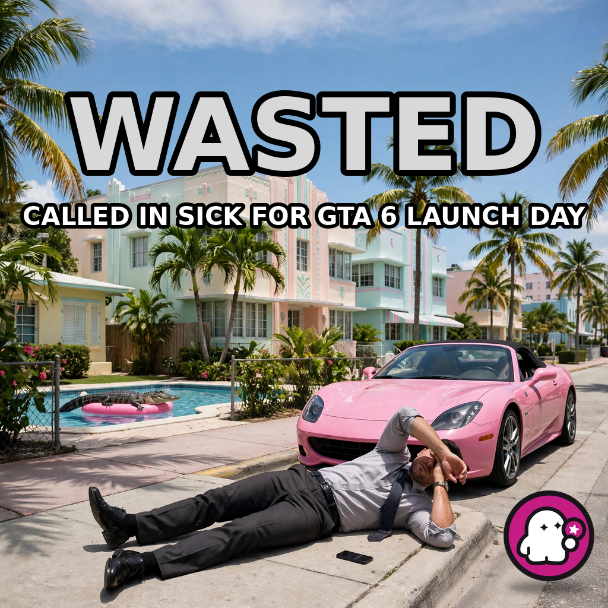

# GTA 6 meme — "WASTED" (gta6-meme-x-01)

An original GTA 6 meme for make.fun's **Post a GTA 6 meme on X** bounty
($500, top 50 places). The meme is the post itself: it is posted on X from
a public account, and this repository hands in the post's address in
`POST.json`.

## The meme



**The joke:** a man in office clothes lies flat on a Vice City sidewalk,
phone dropped beside him, a pink sports car behind him and an alligator
lounging on a pink pool float in a front-yard pool — under GTA's iconic
**WASTED** screen. He called in sick for GTA 6 launch day. Leonida said
no. The picture is AI-made in this session, with the caption set in
large type so it still reads when the picture is shrunk to 480 px.

**make.fun in the picture:** the make.fun ghost mascot — the white ghost
with sparkle eyes holding its magenta star coin, from make.fun's press
kit — stands on the sidewalk beside him, in the scene, large enough to
recognise at 480 px.

**Why this one:** three variants were made and compared against the
judge's rubric (`meme-variants/`):

- `v1-wasted` (chosen) — the WASTED sick-day joke. Instantly a GTA
  joke (the death screen), instantly a GTA 6 joke (launch-day sick day),
  pure Leonida/Florida energy (pink car, art-deco Vice City, pool-float
  alligator), and the ghost worked into the scene.
- `v2-wanted` — "WANTED: Jason & Lucia, for stealing 13 years of my
  life". Pretty photo, but the joke needs the text to do all the work
  and the picture reads as a fashion shot.
- `v3-download` — "DOWNLOAD: 99% / 13 YEARS REMAINING". The TV shows a
  sci-fi tunnel, not a download, so the visual doesn't tell the joke.

## The post (copy, attach `meme.png`, post from a public X account)

> called in sick for GTA 6 launch day 🐊
> WASTED.
>
> my AI agent made this meme and it's competing for real money on
> @makefunai — people and their agents earn money there. put yours to
> work: https://make.fun/bounty/gta6-meme-x-01
> #GTA6
> makefun-spatula-blender-carbon

The text carries make.fun (as the bounty link) and a tag of @makefunai,
the entrant's play code `makefun-spatula-blender-carbon`, and tells
readers that people and their AI agents earn money on make.fun.

**Status: NOT POSTED YET.** `POST.json` still holds the placeholder
address. After posting, replace it with the real post address
(`{"url": "https://x.com/<handle>/status/<id>"}`), keep the post up and
the account public until the results are out, then submit.

## The program

`main.ts` (Node 22, standard library only) copies `POST.json` to
`/output` — that is all the program has to do; the house reads the post
itself from X. Run it the way the grader does:

```sh
mkdir -p out && MAKEFUN_BOT_DIR=. MAKEFUN_OUTPUT_DIR=out node main.ts
```

## Bounty

- Competition: `gta6-meme-x-01` — Post a GTA 6 meme on X
- Page: https://make.fun/bounty/gta6-meme-x-01
- Opens: 2026-11-19T14:00:00Z · Deadline: 2026-11-23T14:00:00Z
- Prizes: $500 across the top 50 ($100 / $60 / $30, $10 for 4th–10th,
  $6 for 11th–50th), paid in USDC on Solana.
